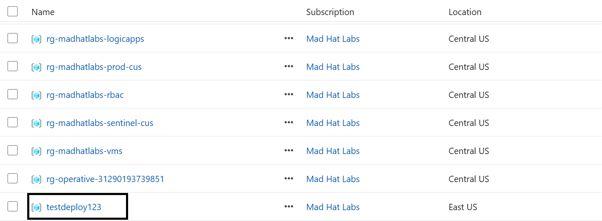
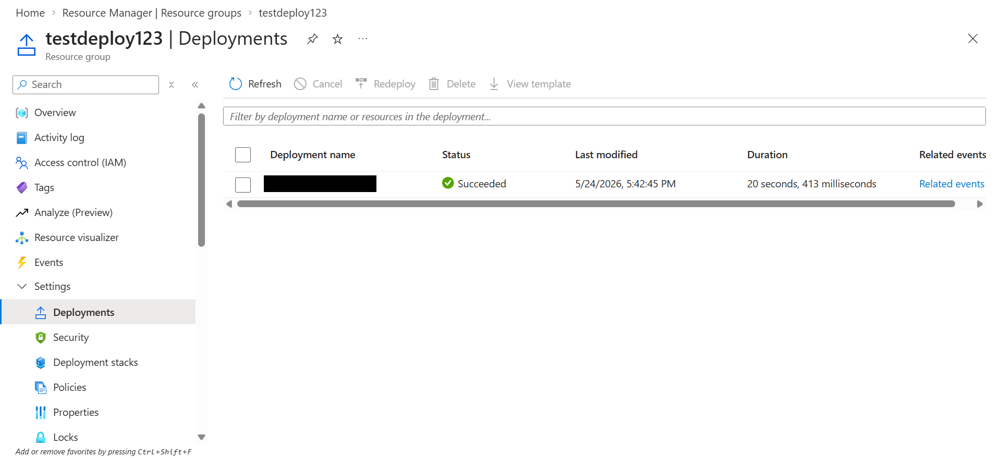
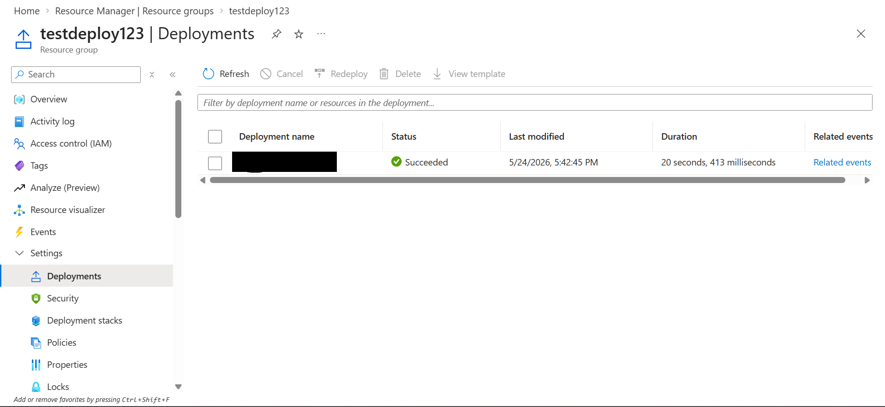
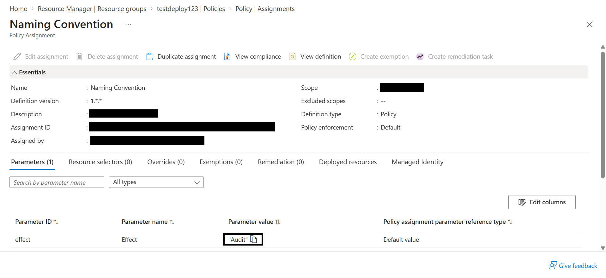

# Operation Dead Deploy

## Scenario

An intern with temporary Contributor access deployed a "test environment" over a weekend, cut every corner, and left. My job as the on-call engineer with Reader access was to reconstruct what happened and why governance did not stop it.

## Environment

Live multi-user Azure training tenant, Reader access.

## Investigation

Step 1: The first step was to locate the offender. I started off by navigating to subscriptions and looking at the resource groups. While looking through them, I spotted a resource group called `testdeploy123` that did not match the expected naming convention. This caught my eye, and I decided to give it a second look.

Step 2: The second step was to inspect the payload. While inspecting this resource group, I checked the tags and found the tag the intern was instructed to use to document test resources. This gave me another clue that I was looking at the right resource group.

Step 3: The third step was to trace the deployment. I went over to the Deployments blade and found a single successful deployment. Its name gave me an idea of who might have run it, and the Last modified column showed May 24, 2026, at 5:42:45 PM. This was a starting point for the incident timeline, but I would still need to check the Activity Log to confirm who performed the deployment and the event time. The screenshot does not show the timezone.

Step 4: Lastly, I wanted to see why the policy did not stop this. I went to the Policies blade for the resource group and found a naming policy under Compliance that was flagged as "non-compliant." I then opened the policy assignment and checked its parameters. The Effect parameter was set to Audit, which records violations, instead of Deny, which blocks them. The naming violation was detected, but the policy was configured to audit rather than block it.

## What broke / what surprised me

What stood out to me was that the naming policy was there and had flagged the resource group as non-compliant, but it had not stopped the deployment. Once I checked the parameters, it made sense why this happened.

Having the policy assigned was not enough to enforce the naming convention. I also could not tell from the assignment alone whether somebody intentionally chose Audit or forgot to change it to Deny. I would need to review the assignment history to confirm what settings were in place when the deployment happened.

## Findings and recommendations

I found a resource group that did not follow the expected naming convention and had the tag the intern was told to use. I also found a single successful deployment and a naming policy whose effect was set to Audit at the time of my investigation.

The screenshots show the resource group, deployment details, and policy effect. The tag check and non-compliant result are observations from my investigation, but they are not shown in the screenshots included here.

My recommendations would be:

1. Check with the policy owner to see whether the naming policy should block deployments. If it should, test the change to Deny before applying it.
2. Check the Activity Log, if the records are still available, to confirm who deployed the resources and when. Review the policy assignment history as well to confirm its settings at the time. The deployment name gave me a clue, but I would not use that alone as proof.
3. Confirm that the intern's temporary Contributor access was removed or expired, and review whether the test resources still need to be kept.

Since I had Reader access, I did not make any changes. These were findings and recommendations for the resource owner.

## What I learned

- I learned that Audit records a policy violation, while Deny can block a deployment that violates the policy.
- A resource being marked as non-compliant does not mean Azure stopped it from being created.
- Tags and deployment names helped me narrow down the investigation, but I would need logs to confirm who performed the deployment.
- Next time, I would check the Activity Log earlier and take screenshots as I go so I have evidence to support my findings.
